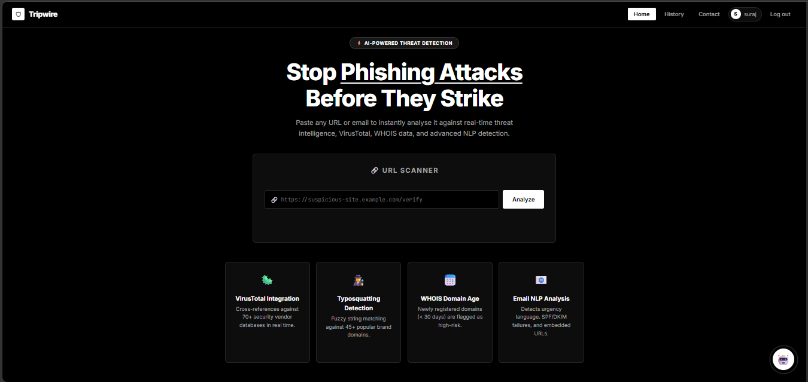
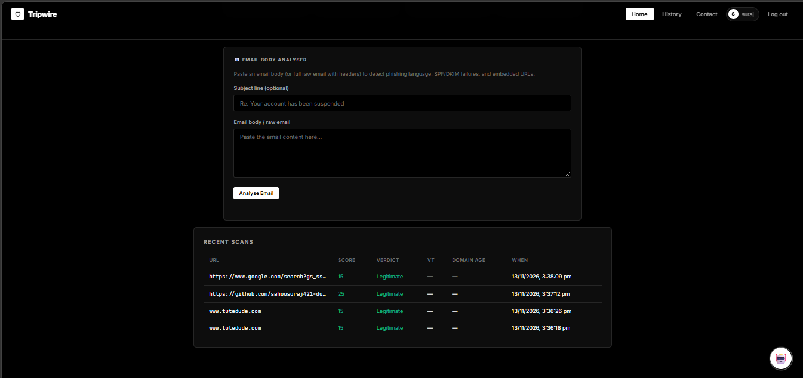

# <p align="center">🛡️ Tripwire: AI-Powered Phishing Detection & Risk Analyzer 🔍</p>

<p align="center">
  <strong>Next-Generation URL & Email Threat Detection with Dual-Role Access, Real-Time Threat Intel, and Floating AI Security Advisor</strong>
</p>

<p align="center">
  
  
  
  
  
</p>

---

## 📸 Application Showcase

Here is a preview of the clean, minimalist black-and-white interface in action:

<div align="center">

### 🔍 Real-Time URL & Threat Intelligence Scanner
*Lexical heuristic inspection, VirusTotal vendor detection, Safe Browsing lookup, domain age, typosquatting warnings, and floating AI Security Advisor.*



<br/><br/>

### 👥 Dual-Role Admin Management Portal
*Full administrative control: user authorization toggling (suspend/activate), role badges, and global scan audit logs.*



</div>

---

## 🌟 Key Features

| Area | Feature Description |
|---|---|
| 🔍 **URL Heuristic Engine** | Deep structural inspection checking IP-as-host, `@` symbols, non-standard ports, punycode/homoglyph attacks, excess subdomains, and suspicious lexical tokens. |
| 🛡️ **Threat Intelligence** | Multi-vendor validation via VirusTotal API (70+ AV engines), Google Safe Browsing v4, WHOIS domain creation age, and Levenshtein typosquatting detection against 45+ trusted global brands. |
| ✉️ **NLP Email Scanner** | Identifies urgency triggers and pressure tactics, inspects SPF/DKIM header authentication flags, and extracts embedded links for automated risk scoring. |
| 🤖 **Floating AI Security Advisor** | Context-aware cybersecurity assistant powered by Qwen2.5-7B with access to the last 10 scans. Seamlessly operates via an interactive floating action button (FAB) with built-in offline incident advisory mode. |
| 👥 **Dual-Role RBAC** | Distinct permissions for `admin` and standard `user` accounts with scrypt password hashing, complexity enforcement, and JWT authentication. |
| 📊 **Incident Export Reports** | Generates Unicode-safe, downloadable CSV and PDF security audit reports (`fpdf2`) with complete threat breakdown. |
| 🔒 **Hardened Architecture** | Protected by SlowAPI rate limiting, strict Content Security Policy (CSP), anti-clickjacking headers, and isolated secret keys. |

---

## 📂 Project Architecture

```
phishing-detector/
├── backend/
│   ├── main.py            # FastAPI routing, middleware, and lifespan handler
│   ├── ml_engine.py       # PhishingFeatureExtractor (lexical heuristics & scoring)
│   ├── email_analysis.py  # NLP email scanner (urgency phrases, SPF/DKIM, links)
│   ├── threat_intel.py    # VirusTotal, Safe Browsing, WHOIS age, typosquatting
│   ├── qwen_service.py    # Hugging Face Qwen client with offline advisory fallback
│   ├── report_generator.py# Unicode-safe PDF (fpdf2) and CSV incident export
│   ├── security.py        # Input validation, scrypt hashing, JWT auth dependencies
│   ├── models.py          # SQLModel User, ScanLog, and EmailScan tables
│   ├── database.py        # SQLite engine, sessions, and schema initializer
│   └── requirements.txt   # Python backend dependencies
├── frontend/
│   ├── index.html         # Responsive SPA (Scanner, History, Admin Portal, Profile)
│   ├── script.js          # Routing, API client, floating advisor widget logic
│   └── styles.css         # Modern high-contrast monochrome design system
├── Outputs/               # Screenshots and visual application previews
│   ├── ui_scanner_dashboard.png
│   └── admin_portal_overview.png
├── test_core.py           # Offline unit test suite (zero network required)
├── test_api.py            # End-to-end smoke test script against running backend
├── docker-compose.yml     # Multi-platform container configuration
├── Dockerfile             # Multi-stage container build
├── .env.example           # Environment template (keys removed for safety)
└── README.md              # Project documentation & visual guide
```

---

## 🚀 Quick Start Guide

### 1. Clone & Enter Project Root

```bash
git clone https://github.com/sahoosuraj421-dot/AI-Powered-Phishing-Detection-URL-Risk-Analyzer.git
cd AI-Powered-Phishing-Detection-URL-Risk-Analyzer
```

> [!IMPORTANT]
> Always execute setup and startup commands from the **project root directory**, not from inside `backend/`.

---

### 2. Set Up Python Virtual Environment

#### On Windows (PowerShell):
```powershell
python -m venv .venv
.\.venv\Scripts\Activate.ps1
```
*(If script execution is restricted in PowerShell, run `Set-ExecutionPolicy -Scope Process -ExecutionPolicy Bypass` first).*

#### On macOS / Linux:
```bash
python3 -m venv .venv
source .venv/bin/activate
```

---

### 3. Install Dependencies

```powershell
python -m pip install -r backend/requirements.txt
```

---

### 4. Configure Environment Variables (`.env`)

Copy the example template to create your `.env`:
```powershell
Copy-Item .env.example .env
```

To generate a secure 48-byte secret key for `JWT_SECRET`:
```bash
python -c "import secrets; print(secrets.token_urlsafe(48))"
```

Configure `.env`:
```ini
# Hugging Face (Optional: built-in offline security advisor answers if omitted)
HF_API_KEY=
HF_MODEL=Qwen/Qwen2.5-7B-Instruct

# JWT Secret Key (required for authentication, minimum 32 characters)
JWT_SECRET=your_generated_secret_key_here

# Database
DATABASE_URL=sqlite:///./phishing.db

# CORS Allowed Origins
ALLOWED_ORIGINS=http://localhost:8000,http://127.0.0.1:8000

# Rate Limiting
RATE_LIMITING_ENABLED=true

# Optional Threat Intelligence Keys
VIRUSTOTAL_API_KEY=
GOOGLE_SAFE_BROWSING_KEY=
```

---

## ⚡ Running the Application

### Option A: Direct Python Runner (Recommended for Local Dev)

```powershell
python -m backend.main
```

### Option B: Uvicorn with Hot Reload

```powershell
python -m uvicorn backend.main:app --reload --host 127.0.0.1 --port 8000
```

### Option C: Docker & Docker Compose

```bash
docker compose up --build
```

---

## 🌐 Web Application Access

Once the server is running, open your web browser:
👉 **[http://localhost:8000](http://localhost:8000)**

### Default Roles & Credentials
The database automatically seeds an initial administrator account upon startup:
- **Admin Username**: `admin`
- **Admin Password**: `Admin@12345`
- Standard users can be self-registered via the **Sign In / Register** tab.

---

## 🧪 Testing Suite

### 1. Offline Unit Test Suite (Zero Network Required)
Tests lexical heuristic calculations, SPF/DKIM flags, password hashing, and Unicode PDF generation:
```powershell
python test_core.py
```

### 2. Live API Smoke Tests
With the server running, test all live endpoints (scan, email analysis, JWT auth, reports, AI advisor):
```powershell
python test_api.py
```

---

## 📡 API Reference & Examples

### 1. Scan a Suspicious URL
```bash
curl -X POST http://localhost:8000/api/scan \
     -H "Content-Type: application/json" \
     -d '{"url":"http://paypa1-secure-login.example.com/verify"}'
```

### 2. Scan an Email Body
```bash
curl -X POST http://localhost:8000/api/email-scan \
     -H "Content-Type: application/json" \
     -d '{
       "subject": "URGENT: Verify your account",
       "raw": "Dear customer, your account is suspended. Click here immediately: http://login-verify.example.com spf=fail dkim=fail"
     }'
```

### 3. AI Security Advisor
```bash
curl -X POST http://localhost:8000/api/chat \
     -H "Content-Type: application/json" \
     -d '{"message":"What should I do if I clicked a suspicious link?"}'
```

---

## 🛡️ Security Best Practices

- **Zero Hardcoded Secrets**: All API tokens and signing keys are read dynamically from `.env` and excluded via `.gitignore`.
- **Safe Fallbacks**: In the absence of third-party API keys (HuggingFace, VirusTotal), the system gracefully continues operation utilizing deterministic heuristic scoring and offline defensive advisories.
- **Strict Content Headers**: Includes anti-sniffing (`X-Content-Type-Options: nosniff`), anti-framing (`X-Frame-Options: DENY`), and modern CSP rules.

---

## 📄 License

This project is licensed under the **MIT License**. Created for security research, incident analysis, and threat awareness.
